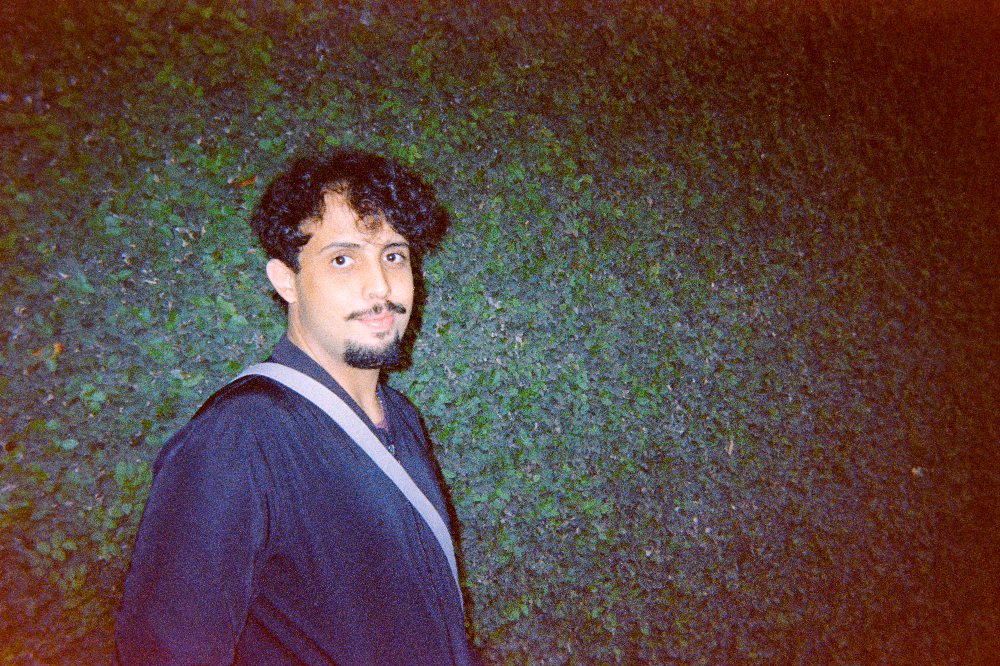
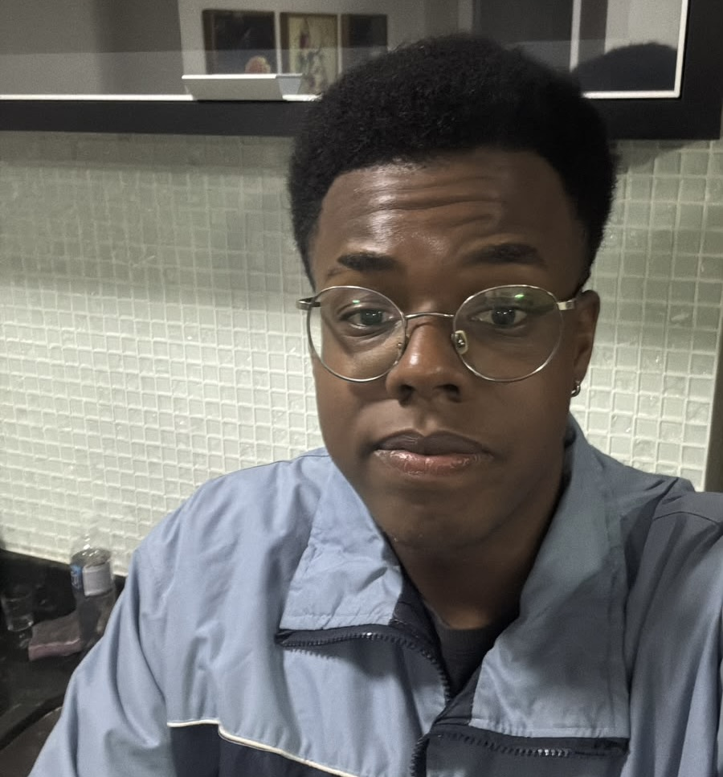
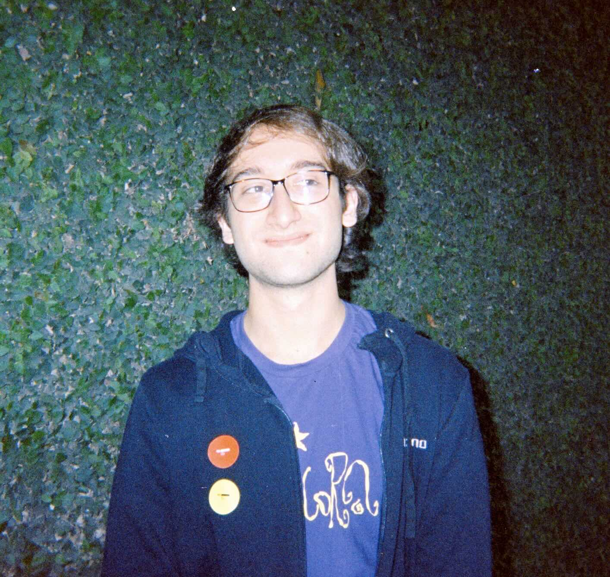
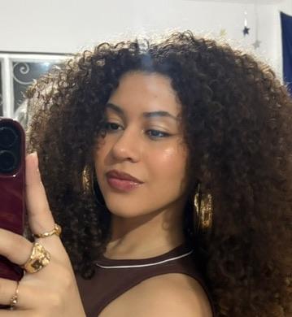

# Evangeline is a Witch

**Evangeline is a Witch** é um roguelite de ação em pixel art para Mac, cheio de combate, humor e feitiços.

O mundo mágico está em perigo! Um magnata ganancioso está enlatando toda a magia da Academia das Bruxas e acabando com o equilíbrio do mundo. E a única pessoa disponível para impedir esse desastre é Evangeline: uma bruxa rebelde, desleixada e completamente incompetente.

## Versão atual

Esta versão traz a primeira parte da jornada de Evangeline. Descubra o perigo que ameaça a Academia das Bruxas, enfrente os inimigos pelo caminho e resgate sua amiga Circe, sequestrada pelo misterioso Magnata Mágico.

## Equipe

Nosso coven inclui 2 vencedores do WWDC, 2 vencedoras de hackathon, 3 diferentes 
áreas de estudo e 4 apps diferentes publicados na App Store.

<table>
  <tr>
    <td align="center" width="25%">
      <a href="https://github.com/sofiavvb"> <b>Sofia Valverde</b></a> 
      Developer & Producer
    </td>
    <td align="center" width="25%">
      <a href="https://github.com/tai-almeida"> <b>Tainá Almeida</b></a> 
      Developer
    </td>
    <td align="center" width="25%">
      <a href="https://github.com/Ldvk-bf"> <b>Ludivik de Paula</b></a> 
      Developer
    </td>
    <td align="center" width="25%">
      <a href="https://github.com/ceciliatv"> <b>Cecília Vianna</b></a> 
      Sound Designer
    </td>
  </tr>
  <tr>
    <td align="center" width="25%">
      <a href="https://github.com/lima042"> <b>Gabriel Lima</b></a> 
      Game Designer
    </td>
    <td align="center" width="25%">
      <a href="https://github.com/[usuario-do-uli]"> <b>Ulisses Guimarães</b></a> 
      Game Designer
    </td>
    <td align="center" width="25%">
      <a href="https://github.com/vinign"> <b>Vinicius Garcia</b></a> 
      Level Designer
    </td>
    <td align="center" width="25%">
      <a href="https://github.com/camilleluppi"> <b>Camille Luppi</b></a> 
      Artist
    </td>
  </tr>
</table>

## Suporte

Dúvidas, sugestões ou problemas com o jogo? Fale com a gente:

- **E-mail:** [evangelineisawitch@gmail.com](mailto:evangelineisawitch@gmail.com)
- **Instagram:** [@evangelineisawitch](https://www.instagram.com/evangelineisawitch)

### Encontrou um bug?

Por enquanto, os bugs são recebidos por esses mesmos canais. Para ajudar a gente a encontrar e corrigir o problema, conte:

1. o que aconteceu e o que você esperava que acontecesse;
2. onde aconteceu (por exemplo, no tutorial, no hub ou em qual sala);
3. a versão do jogo e a versão do macOS;
4. se possível, um print ou vídeo.

## Privacidade

Veja a [Política de Privacidade](politica-de-privacidade.md) para saber quais dados o jogo coleta e como eles são usados.